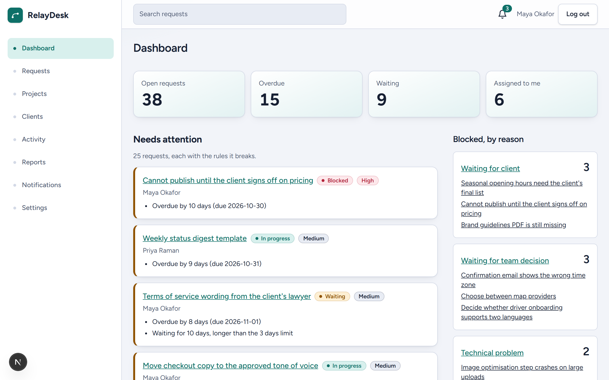
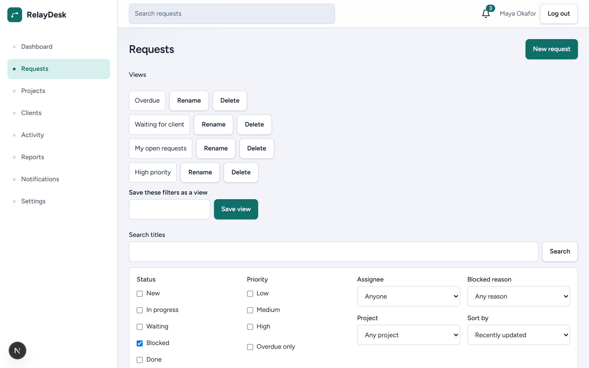
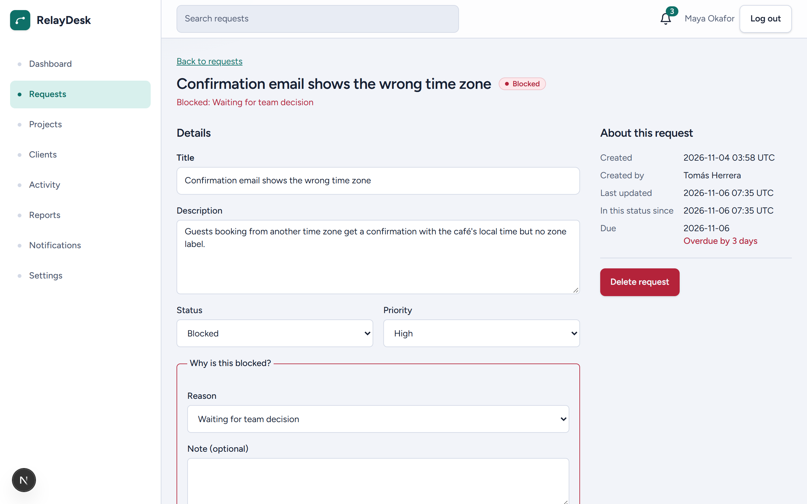
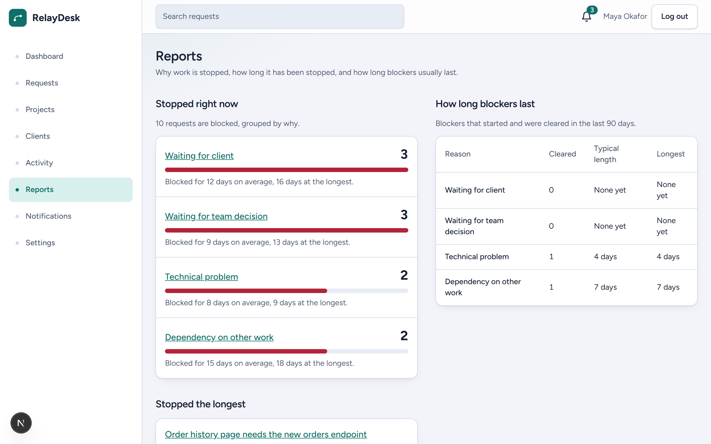
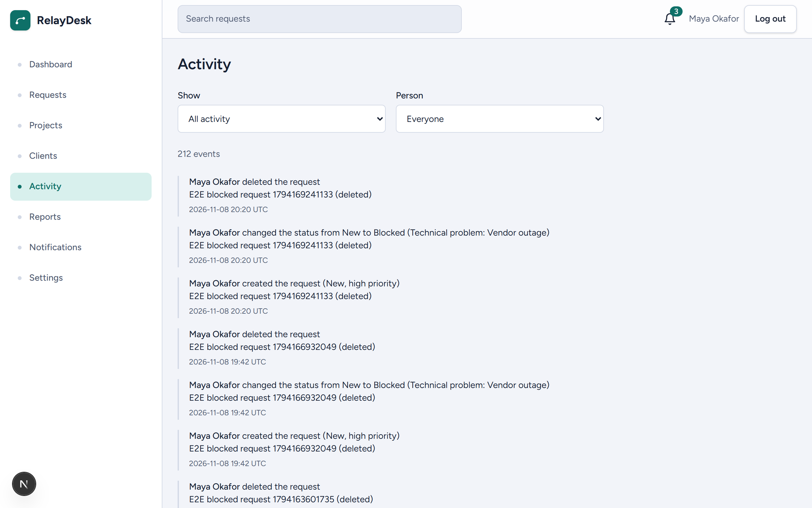
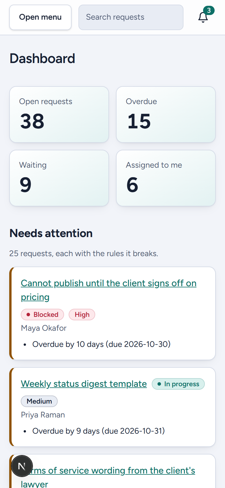

# RelayDesk

RelayDesk is a workspace for small teams that work asynchronously and need to follow up on stuck work. It tracks requests like a board would, but it treats the reason work is stopped as data: a request cannot be Blocked without saying why, and the dashboard, filters and activity history can all be read by that reason.

**Live demo:** [relaydesk.mahsanasiry0.workers.dev](https://relaydesk.mahsanasiry0.workers.dev). The [sample workspace](https://relaydesk.mahsanasiry0.workers.dev/demo) opens without an account.



## Try it

The sample workspace link signs in as a demo user in a workspace full of fictional requests, so there is nothing to register. The demo password is public, which means anyone can change the sample data. `npm run seed:reset` restores it.

## Screenshots









The layout follows the screen width:



## The problem

Small agencies and product teams lose time to requests that quietly stall. A task moves to "Waiting" and nobody remembers what it was waiting for, who was meant to chase it, or for how long. A board shows where a card sits, not why it stopped, so follow-ups depend on someone's memory.

## Who it is for

- Team leads who need to see, each morning, what is stuck and what is overdue.
- Team members who need to know what is assigned to them and what changed while they were away.
- Client-facing staff who need to tell a client exactly what a request is waiting on.

## Features

- **Statuses with a reason.** New, In Progress, Waiting, Blocked and Done. Blocked requires one of four reasons (waiting for client, waiting for team decision, technical problem, dependency on other work) and accepts a note.
- **Dashboard built from real data.** Open, overdue, waiting and assigned-to-me counts, blocked work grouped by reason, a project summary, recent activity, and a Needs Attention list where each item states the rule that put it there.
- **Requests list.** Search, filters (status, priority, assignee, project, blocked reason, overdue), sorting and pagination. All of it lives in the URL, so a filtered list can be bookmarked, shared and refreshed. Bulk actions change status (with a reason when blocking), priority, assignee, or archive.
- **Request detail.** Edit, comments, a filterable activity timeline, related requests, and delete.
- **Projects and clients.** Lists, detail pages, create and edit, with open-request counts.
- **Workspace activity.** Every change across the workspace, filterable by kind of event and by person.
- **Reports.** What is blocked right now, grouped by reason with how long each group has been stuck. The requests blocked the longest. How long blockers lasted over the last 90 days, worked out from the activity history.
- **Notifications.** When a request is assigned to you, when someone comments on it, when a due date is close, and when a blocked request is unblocked. Unread count in the header, mark one or all as read.
- **Saved views.** Four presets (My Open Requests, High Priority, Waiting for Client, Overdue) plus your own: save, rename, delete and apply.
- **Settings.** Your name, the workspace name, and the two thresholds that drive Needs Attention.

## Why it is designed this way

- **A reason is data, not a comment.** The database refuses a Blocked request without one, so every screen and report can rely on it being there.
- **Reports come from history the app already keeps.** The time a request has been blocked comes from when its status last changed. The time blockers took to clear comes from pairing status changes in the activity log. There are no separate analytics tables to drift out of sync.
- **Status is never colour alone.** Each badge carries its name and a dot, and colour only reinforces it. Red is kept for blocked work, high priority and destructive actions, so it keeps its meaning.
- **Nothing is scored.** Needs Attention follows four stated rules in a stated order. A person can read why a request is on the list and disagree with it.
- **Lists live in the URL.** A filtered view can be bookmarked or sent to a teammate, and it survives a refresh.
- **The scope is small on purpose.** There is no email, chat, payments or AI. The product is the model of why work is delayed, and the rest would only dilute it.

## Stack, and why

| Choice                                                 | Reason                                                                                                    |
| ------------------------------------------------------ | --------------------------------------------------------------------------------------------------------- |
| Next.js (App Router), React, TypeScript in strict mode | Server Components for pages and auth checks, Client Components only where there is interaction.           |
| Tailwind CSS with CSS-variable tokens                  | One place to change colour and spacing, and a dark-mode-ready palette without per-component overrides.    |
| TanStack Query                                         | Caching, invalidation after mutations and retry control without hand-written fetch state.                 |
| React Hook Form with Zod                               | Forms validate with the same schemas the data layer relies on, and errors map to fields.                  |
| Supabase (Postgres, Auth)                              | Row level security keeps tenant isolation in the database, so it holds even if application code is wrong. |
| Vitest and Testing Library                             | Fast unit and component tests; business rules are pure functions and are tested without rendering.        |
| Playwright and axe-core                                | Real-browser journeys and an automated accessibility scan.                                                |

## Architecture

```
src/
  app/            Routes, layouts and metadata. Pages are thin and delegate to features.
  features/       One folder per domain: requests, projects, clients, activity,
                  comments, notifications, saved-views, settings, dashboard, reports, auth.
  components/     ui (buttons, fields, dialogs), layout (shell, nav), shared (data list, pagination).
  lib/            supabase clients, query client and keys, validation schemas, utilities.
  tests/          unit (Vitest) and e2e (Playwright).
supabase/migrations/   Schema, triggers and row level security, applied in order.
scripts/seed/          Demo data loader.
```

Decisions worth knowing about:

- **Rules are pure functions.** Status changes, Needs Attention, filtering and sorting, the dashboard summary and bulk patches take plain values and return plain values. Components call them; they do not contain them.
- **The URL is the state for lists.** `RequestQuery` is parsed from and serialised to search parameters in one place, so there is one canonical URL per filter set.
- **The database writes history.** Triggers record activity events and create notifications when a signed-in user changes a request or adds a comment, so the history cannot be skipped by a client.
- **Authentication is checked twice.** A proxy rejects missing sessions early, and the app layout asks the auth server for the user before rendering anything.

## Data model

| Table                 | Holds                                                                                |
| --------------------- | ------------------------------------------------------------------------------------ |
| `workspaces`          | Name and the two Needs Attention thresholds.                                         |
| `profiles`            | One row per user, tied to a workspace.                                               |
| `clients`, `projects` | Who the work is for and how it is grouped.                                           |
| `requests`            | Status, blocked reason and note, priority, assignee, due date, labels, archive flag. |
| `request_relations`   | Links between requests, stored once per pair.                                        |
| `comments`            | Comments, which cannot be edited or deleted.                                         |
| `activity_events`     | Read-only history, written by triggers.                                              |
| `notifications`       | Per-user notifications with a de-duplication key.                                    |
| `saved_views`         | Per-user named filter sets.                                                          |

Every table has row level security. Rows are visible only within the signed-in user's workspace; notifications and saved views are visible only to their owner. Composite foreign keys on `(workspace_id, id)` stop a row from referencing another workspace's data. A new account starts in its own workspace.

## Needs Attention rules

A request that is open (not Done, not archived) is listed if it breaks any of these rules. It is shown under the first rule it breaks, in this order, and every broken rule is stated next to it.

1. **Overdue.** The due date has passed. The message says by how many days.
2. **High priority, due soon.** High priority and due within the workspace's due window (default 2 days), including today.
3. **Waiting too long.** Status is Waiting and has been for longer than the workspace's waiting threshold (default 3 days).
4. **Unassigned.** Nobody is assigned.

There is no score and no hidden weighting. The order of the list follows from the order of the rules, then the earliest due date, then the title. Both thresholds are editable in Settings.

## Setup

Requirements: Node.js 22.18 or newer (22.12 is enough to run the app; the seed script uses native TypeScript and needs 22.18), npm, and a Supabase project (PostgreSQL 15 or newer).

1. Install dependencies.

   ```
   npm install
   ```

2. Create a Supabase project, then copy `.env.example` to `.env.local` and fill in:
   - `NEXT_PUBLIC_SUPABASE_URL` and `NEXT_PUBLIC_SUPABASE_PUBLISHABLE_KEY` from Project Settings, API.
   - `SUPABASE_SECRET_KEY`, only to run the seed script. It bypasses row level security. Keep it out of hosting environments and out of git.

3. Apply the migrations in `supabase/migrations/`, in file-name order, using the Supabase SQL editor or the Supabase CLI.

4. Load the demo workspace.

   ```
   npm run seed
   ```

   Run `npm run seed:reset` to delete the demo workspace and load it again. The demo accounts end in `@relaydesk.example` and share the password in `SEED_DEMO_PASSWORD`, or `RelayDesk-demo-2026` when that is empty.

5. Start the app.

   ```
   npm run dev
   ```

## Scripts

| Script                                   | Purpose                                  |
| ---------------------------------------- | ---------------------------------------- |
| `npm run dev`                            | Development server.                      |
| `npm run build`, `npm run start`         | Production build and server.             |
| `npm run lint`                           | ESLint.                                  |
| `npm run typecheck`                      | TypeScript without emitting.             |
| `npm run format`, `npm run format:check` | Prettier, write or verify.               |
| `npm run test`                           | Unit and component tests.                |
| `npm run test:e2e`                       | Browser journeys and accessibility scan. |
| `npm run seed`, `npm run seed:reset`     | Load or reload demo data.                |
| `npm run screenshots`                    | Regenerate the images in the README.     |

## Testing

- **Unit and component tests** (`npm run test`) cover the pure rules (status changes, Needs Attention, filters, bulk patches, saved views, validation) and every screen's loading, empty, error and success states.
- **End-to-end tests** (`npm run test:e2e`) need the app running against a Supabase project that holds the demo data. Install the browser once with `npx playwright install chromium`. If that download is not available where you are, set `E2E_BROWSER_CHANNEL` to `msedge` or `chrome` to use the browser already installed on the machine. The tests sign in once and reuse that session, because the hosted auth service limits how often an account can sign in. They then create a request, block it with a reason, find it through the URL, check the dashboard and the activity, save and delete a view, use the mobile menu and open the demo link. They clean up what they create. On a slow connection to Supabase a local run can time out, so the end-to-end workflow on GitHub is the reliable way to run them. `E2E_EMAIL`, `E2E_PASSWORD` and `E2E_BASE_URL` override the defaults.
- **Accessibility** is scanned with axe-core on every page against WCAG 2.0 and 2.1 level A and AA. Automated scans find only part of the problems, so keyboard use and screen reader behaviour still need manual review.

The README images come from `npm run screenshots`. It signs in through the demo link and saves the pictures to `docs/screenshots`. Set `E2E_BASE_URL` to capture a deployed site instead of the local server.

## Continuous integration

Pull requests and pushes to `main` run formatting, lint, typecheck, unit tests and a production build, plus an audit of production dependencies. The end-to-end workflow is started by hand from the Actions tab because it needs a Supabase project with demo data. It reads `E2E_SUPABASE_URL` and `E2E_SUPABASE_PUBLISHABLE_KEY` from repository secrets; it does not need the secret key.

## Deployment

The app runs on Cloudflare Workers through the OpenNext adapter. `docs/deployment.md` describes the full setup: Supabase for the database and authentication, GitHub for the repository and CI, and Cloudflare for hosting. The only values the hosted app needs are the Supabase URL and the publishable key. The secret key is for the seed script and must never be added to the hosting environment.

## Trade-offs

- **Lists are filtered in the browser.** Requests are loaded once and filtered, sorted and paginated on the client, which keeps filtering instant and the URL logic simple. It does not scale to tens of thousands of requests; loading stops at 10,000. The next step would be to move filtering into the query.
- **Last write wins.** Two people editing the same request at once do not see each other's unsaved changes, and the later save overwrites the earlier one.
- **No live updates.** Data refreshes on navigation and when the window regains focus. The notification badge polls once a minute.
- **Activity is written by triggers, not application code.** That makes it reliable, but it means history is only recorded for signed-in users, and changes made with a service key are not logged.
- **The Cloudflare adapter is young.** Running Next 16's `proxy.ts` on Workers is marked experimental by the adapter, and its build prints a warning. The adapter is a build-time dependency. Its build tooling has had audit advisories, which is why the production audit runs without development dependencies.
- **Cleared-blocker times depend on the activity log.** A blocker that started before the 90-day window, or whose request was deleted while blocked, is left out rather than guessed at.
- **The trigram index on request titles is not used yet.** Search runs in the browser. The index is there for when search moves server-side.

## Limitations

- One workspace per account. Inviting people into an existing workspace is a server-side operation, not a screen.
- No roles: everyone in a workspace can edit everything except comments, which are permanent.
- Projects and clients cannot be deleted, only edited.
- Email and chat notifications are not sent. Notifications exist only inside the app.
- Dates are calendar dates without time zones, and timestamps are shown in UTC.

## Licence

All rights reserved.
